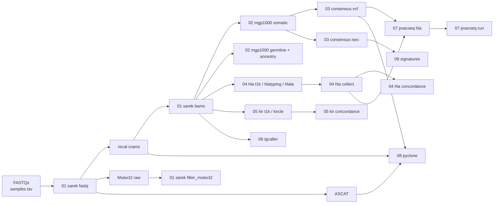

# Stages: what each step reads and writes

Run every step as `./wes.sh <stage> <step>`. Paths below use the variables
from `config/pipeline.config` (`$BATCH_DIR` = `$HOME/Scratch/AMATTA/<BATCH_NAME>`).
`<T>` = tumour sample, `<N>` = normal sample, `
` = patient. Pairs are
named `<T>_vs_<N>`, as in sarek.

## 01 sarek

| Step | Needs | Writes |
|---|---|---|
| `fastq` | FASTQs listed in `samples.tsv` | `$SAREK_DIR/preprocessing/{mapped,recalibrated}/<S>/`, `$SAREK_DIR/variant_calling/{mutect2,strelka,ascat,cnvkit,manta}/<T>_vs_<N>/` |
| `cram` | recal crams (sarek's, or the `cram` column) | `variant_calling/` only (`--step variant_calling`) |
| `bams` | recal crams | `$BAM_DIR/<S>.recal.bam` (+ `.bai`). Needed by stages 02, 04, 05 and 06 |
| `filter_mutect2` | `variant_calling/mutect2/<T>_vs_<N>/<T>_vs_<N>.mutect2.vcf.gz` | `$MUTECT2_DIR/<T>_vs_<N>.mutect2_filtered.vcf.gz` + `.maf` (Funcotator) |

Generated sheets: `$SAMPLESHEET_DIR/sarek_fastq.csv`, `sarek_cram.csv`.

## 02 mgp1000

| Step | Needs | Writes |
|---|---|---|
| `somatic` | recal bams for every pair | bams hard-linked as `$MGP1000_INPUT_DIR/<S>.final.bam` (+ `.bai`), sheet `$SAMPLESHEET_DIR/mgp1000_somatic.csv`; mgp1000 writes `$MGP1000_SOMATIC_DIR/{mutect,strelka,varscan,consensus,...}/` |
| `germline` | recal bam of every normal | sheet `$SAMPLESHEET_DIR/mgp1000_germline.csv` (one row per normal); mgp1000 writes `$MGP1000_GERMLINE_DIR/<N>.deepvariant.germline.snp.indel.vcf.gz` and ancestry `$MGP1000_GERMLINE_DIR/<N>/<N>.fastngsadmix.23.qopt` |

Germline runs DeepVariant and fastNGSadmix ancestry (`MGP1000_GERMLINE_TOOLS`); fastNGSadmix needs the `fastNGSadmix_markers*` files in `$MGP1000_DIR/references/hg38/`, and the launcher warns if they are missing. The somatic tools are set by `MGP1000_SOMATIC_TOOLS` in the config
(Mutect2, Strelka, VarScan, Manta, Delly, IgCaller on; Battenberg, SvABA,
CaVEMan, Conpair and the telomere tools off). The
preprocessing-from-FASTQ command is kept, commented, in `mgp1000.job.sh`.

## 03 consensus

| Step | Needs | Writes |
|---|---|---|
| `vcf` | `$MGP1000_CONSENSUS_GLOB` (`consensus/<T>_vs_<N>/*.hq.union.consensus.somatic.snv.txt.gz`) | `$CONSENSUS_DIR/filtered/*.callers_ge2.txt.gz` → `$CONSENSUS_DIR/vcf/*.vcf` → linked per patient into `$CONSENSUS_DIR/pvacseq_input/
/` |
| `isec` | `$MGP1000_SOMATIC_DIR/{mutect,strelka,varscan}/*.somatic.snv.vcf.gz` | `$CONSENSUS_DIR/isec/normalized/`, `isec/variant_tsv/<pair>.snv.filtered.variants.tsv`, `isec/sample_order_check.log` (check the VarScan rows) |

`vcf` keeps sites that PASS in at least `CONSENSUS_MIN_CALLERS` callers (default 2).
`isec` applies the hard filters from `merging_results.sh` and keeps sites found
by at least 2 of the 3 callers.

## 04 hla (normals, keyed by patient)

| Step | Needs | Writes |
|---|---|---|
| `t1k` | normal bams, `$T1K_DIR/hlaidx/` | `$HLA_DIR/T1K/
_HLA_genotype.tsv` |
| `hlatyping` | normal bams, `HLATYPING_DIR` (patched checkout), `HLAHD_TARBALL` | `$HLA_DIR/hlatyping/` (OptiType, HLA-HD) |
| `hlala` | normal bams, `hla-la` env with graph | `$HLA_DIR/HLA_LA/
/hla/R1_bestguess_G.txt` |
| `collect` | any of the above (searches all of `$HLA_DIR`, so older runs written straight into `HLA/` are found too) | `$HLA_DIR/calls/{t1k,optitype,hlahd,hlala}/
_*` (one flat folder per caller) |
| `concordance` | `calls/`, `HLA_TRUTH` | `$HLA_DIR/HLA_typing_comparison.xlsx` |

## 05 kir (normals, keyed by patient)

| Step | Needs | Writes |
|---|---|---|
| `t1k` | normal bams, `$T1K_DIR/kiridx/` | `$KIR_DIR/T1K/
_KIR_genotype.tsv` |
| `kircle` | normal bams, `$KIRCLE_DIR` | `$KIR_DIR/KIRCLE/
/` |
| `concordance` | T1K results, optional `KIR_TRUTH` | `$KIR_DIR/KIR_concordance.xlsx` |

## 06 igcaller

| Step | Needs | Writes |
|---|---|---|
| `run` | mapped bams (`preprocessing/mapped/`, falls back to recal) for each pair | `$IGCALLER_DIR/<T>/` |

## 07 pvacseq (joins 03 + 04)

| Step | Needs | Writes |
|---|---|---|
| `hla` | `$CONSENSUS_DIR/pvacseq_input/
/`, `$HLA_DIR/calls/<HLA_SOURCE_FOR_PVACSEQ>/` | `$PVACSEQ_DIR/hla/
.csv`: one row per tumour VCF sample, class I alleles. **Check these before `run`** |
| `run` | the above + `PVACSEQ_PIPELINE`, IEDB, VEP plugins | `$PVACSEQ_DIR/
/` |

## 08 pyclone (per patient, all timepoints together)

| Step | Needs | Writes |
|---|---|---|
| `run` | for every tumour: its 2-of-3 consensus VCF in `$CONSENSUS_DIR/vcf/` (stage 03 `vcf`), ASCAT `*.cnvs.txt` + `*.purityploidy.txt`, recal cram | `$PYCLONE_DIR/
/`: `manifest.tsv`, `
.union_sites.tsv`, `counts/<T>.forced.tsv`, `
.pyclone_vi.tsv`, `
.h5`, `
.results.tsv`, cluster table + CCF plot |

The job runs, in order: the union of consensus SNVs across timepoints, forced
allele counts at every union site in every sample (alleleCounter), the
PyClone-VI table, the fit, then the summary.

## 09 signatures

| Step | Needs | Writes |
|---|---|---|
| `input` | `$CONSENSUS_DIR/isec/variant_tsv/*.tsv` | `$CONSENSUS_DIR/isec/mmsig_input.tsv`, which you then run through MMSig in R (set hg38) |
